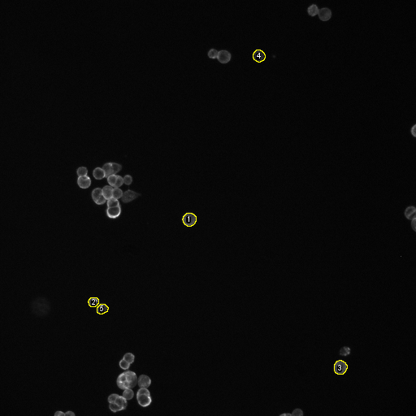
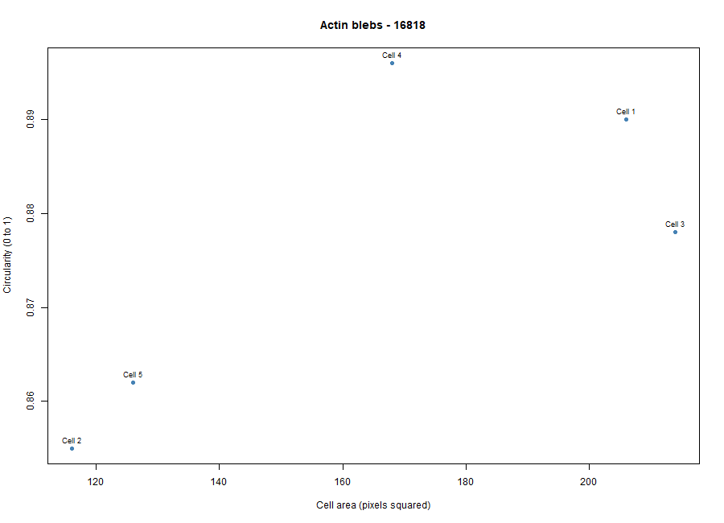
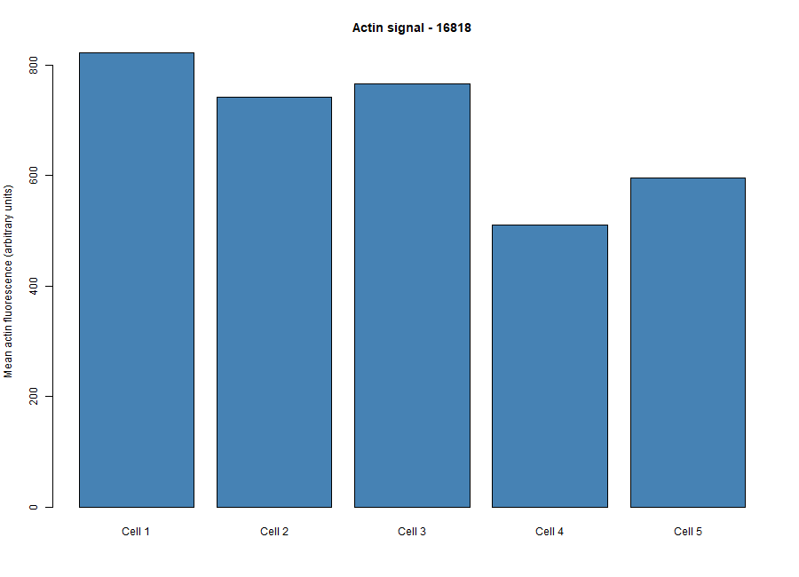

# Cytoskeleton and Cell Morphology Analysis (BBBC018)

**Karp Chapter 9: The Cytoskeleton and Cell Motility**

**Student ID:** [202400735]  
**Dataset:** BBBC018 - Human HT29 Colon-Cancer Cells  
**Selected Phenotype:** Actin blebs
**Image-Field ID:** 16818

---

## Introduction

The cytoskeleton plays an important role in maintaining cell shape, providing structural support, and allowing cells to change their morphology. In this activity, fluorescence images of HT29 human colon-cancer cells from the BBBC018 dataset were examined to observe F-actin distribution and cell shape.

The selected phenotype was Actin blebs. Five cells were measured using Fiji and their measurements were analyzed in R to compare cell area, circularity, aspect ratio, and mean actin fluorescence intensity.

---

## Dataset and Selected Images

The fluorescence images were obtained from the Broad Bioimage Benchmark Collection (BBBC018).

- **Dataset:** [BBBC018](https://bbbc.broadinstitute.org/BBBC018)
- **Download:** [BBBC018_v1_images.zip](https://data.broadinstitute.org/bbbc/BBBC018/BBBC018_v1_images.zip)
- **Phenotype:** Actin blebs
- **Image-field ID:** 16818
- **Actin filename:** `16818-actin.DIB`
- **DNA filename:** `16818-DNA.DIB`

The actin channel was used to examine F-actin staining and trace cell boundaries, while the DNA channel served as a guide for identifying nuclei and distinguishing neighboring cells.

---

## Methods

### Fiji Analysis

- The matching actin and DNA fluorescence images were opened in Fiji using Bio-Formats.
- Cell outlines were examined, and five cells with distinguishable boundaries were selected.
- Area, Mean gray value, Shape descriptors, and Display label were enabled under Set Measurements.
- The Freehand Selection tool was used to trace each cell, and the selections were added to ROI Manager.
- All five cells were measured, and the measurements were saved as `data/fiji_results.csv`.
- The annotated fluorescence image showing the five labeled cells was saved as `figures/measured_cells.png`.

### R Analysis

- The Fiji measurements were imported into RStudio using an R script.
- With the guide of the provided R code, the mean cell area, circularity, aspect ratio, and actin fluorescence intensity of the five measured cells were calculated.
- Two graphs were also generated (using the format of the provided R code) to compare cell area versus circularity and the mean actin fluorescence intensity of the five cells.

---

## Results

The following figures present the results of the cell morphology analysis using Fiji and RStudio. Five HT29 cells from image field 16818 were examined to determine their cell area, circularity, aspect ratio, and mean F-actin fluorescence intensity.

### Five Measured HT29 Cells

The fluorescence image was opened in Fiji, where five cells with distinguishable boundaries were selected and traced using the Freehand Selection tool. Each cell outline was added to ROI Manager, and the Show All and Labels options were enabled to display the five numbered outlines. The annotated image was then saved for documentation.

**Figure 1.** F-actin fluorescence image of HT29 cells from field 16818, showing the five selected cells outlined and numbered using Fiji.

### Cell Area versus Circularity

Using the measurements obtained from Fiji, a scatter plot was generated in RStudio to examine the relationship between cell area and circularity among the five selected cells.

**Figure 2.** Scatter plot showing the relationship between cell area and circularity among the five measured HT29 cells.

The cells had areas ranging from 116 to 214 pixels², with Cell 3 having the largest area. Circularity values ranged from 0.855 to 0.896 with a mean of 0.8762. This indicates that the measured cells were predominantly rounded despite differences in size. The results showed no clear relationship between cell area and circularity, as larger cells were not necessarily more or less circular than smaller cells.

### Mean Actin Fluorescence Intensity

A bar graph was also generated using the provided R code to compare the mean F-actin fluorescence intensity of the five measured cells.

**Figure 3.** Bar graph comparing the mean F-actin fluorescence intensity of five HT29 cells from image field 16818.

Cell 1 showed the highest mean F-actin fluorescence intensity at 823.117 AU, while Cell 4 obtained the lowest at 510.982 AU. The average intensity across all five cells was 687.333 AU. These results indicate variations in the mean F-actin fluorescence intensity among the measured cells which suggests differences in the distribution and intensity of actin staining within the same image field.

---

### Cell Measurement Summary

The table below presents the average measurements of the five selected HT29 cells obtained through Fiji and analyzed using RStudio.

| Measurement | Mean Value |
|---|---:|
| Cell area | 166 pixels² |
| Circularity | 0.8762 |
| Aspect ratio | 1.1134 |
| Actin fluorescence intensity | 687.333 AU |

The five measured cells had an average area of 166 pixels², indicating differences in cell size as observed in the previous figure. The mean circularity of 0.8762 and aspect ratio of 1.1134 suggest that the cells were generally rounded rather than elongated. Meanwhile, the average F-actin fluorescence intensity of 687.333 AU represents the overall mean actin staining signal of the five cells within the selected image field.

---

## Guide Questions

***1. Which specific phenotype did you choose, and what visible features support that choice?***

Actin blebs was my chosen phenotype. In the fluorescence image, most cells appeared rounded, with bright F-actin staining along their edges and some irregularities in their outlines. These features were consistent with the selected phenotype, although individual blebs were difficult to distinguish clearly.

***2. Were your five cells mostly round or elongated? Refer to your circularity and aspect-ratio results.***

The five cells were mostly rounded, with an average circularity of **0.8762** and an average aspect ratio of **1.1134**. Since the circularity values were close to 1 and the aspect ratios were relatively low, the cells showed little elongation.

***3. What role does actin play in maintaining cell shape and in cell movement (Karp Chapter 9)***

Actin is a major component of the cytoskeleton that provides structural support and helps maintain the shape of a cell. It also contributes to cell movement by forming structures such as lamellipodia and filopodia which allow cells to extend their membranes. Through continuous assembly and disassembly of actin filaments, cells can then change shape and move.

***4. Why can a single fixed fluorescence image NOT show how fast a cell moves?***

A single fixed fluorescence image only captures the cell's structure at one point in time. Since it does not show changes in position over time, the cell's movement speed cannot be determined.

## Conclusion

The analysis of five HT29 cells showed that the selected cells were mostly rounded, with slight differences in size, shape, and F-actin fluorescence intensity. Their mean circularity of 0.8762 and aspect ratio of 1.1134 supported the observation that the cells had relatively rounded shapes. Taken together, the activity demonstrated how fluorescence microscopy, Fiji, and R can be used to examine cell morphology and actin organization.

---

## References and Data Sources

Broad Bioimage Benchmark Collection. (n.d.). *BBBC018: Human HT29 colon-cancer cells (diverse phenotypes).* Broad Institute. https://bbbc.broadinstitute.org/BBBC018

Ljosa, V., Sokolnicki, K. L., & Carpenter, A. E. (2012). Annotated high-throughput microscopy image sets for validation. *Nature Methods, 9*(7), 637. https://doi.org/10.1038/nmeth.2083

### Data Credit and Image License

**Data Credit:** We used image set BBBC018v1 from the Broad Bioimage Benchmark Collection (Ljosa et al., Nature Methods, 2012).

**Image License:** Creative Commons Attribution-NonCommercial-ShareAlike 3.0 (CC BY-NC-SA 3.0).
